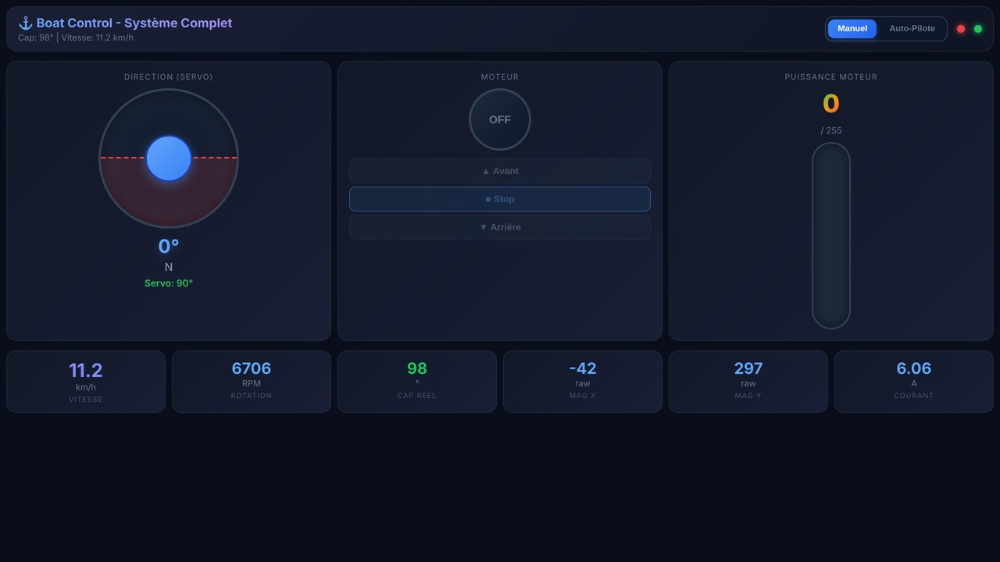
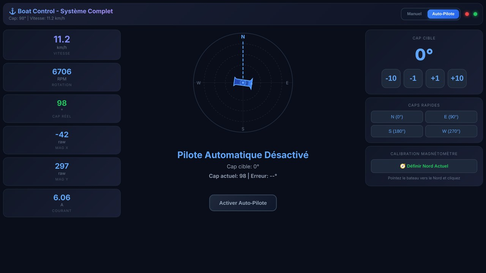

# Firmware du bateau autopiloté (ESP32)

Code embarqué de la version finale (année 2, 2025-2026) et son interface web.

```
firmware/
├── boat_control_final/        ← sketch à ouvrir dans Arduino IDE / VS Code
│   ├── boat_control_final.ino   setup() et loop()
│   ├── config.h                 brochage et paramètres (PID, capteurs…)
│   ├── secrets.example.h        modèle des identifiants Wi-Fi → copier en secrets.h
│   ├── actuators.h/.cpp         moteur (pont en H BTS7960) et servo du safran
│   ├── sensors.h/.cpp           vitesse (LM393), courant (ACS758), cap (BMM150)
│   ├── autopilot.h/.cpp         régulateur PID de cap
│   ├── web_server.h/.cpp        Wi-Fi et API HTTP
│   └── web_page.h               interface web GÉNÉRÉE (ne pas éditer)
├── web/                       ← interface web, éditable séparément
│   ├── index.html
│   ├── style.css
│   └── app.js
├── tools/
│   ├── build_web.py             web/ → boat_control_final/web_page.h
│   └── mock_server.js           simulateur de l'API pour développer l'interface sans matériel
└── historique/                ← versions successives, telles qu'écrites pendant le projet
    ├── v1_capteur_vitesse/
    ├── v2_capteur_courant/
    └── prototype_api_rest_json/ essai d'API REST JSON (POST /command) pour une interface React
```

## Matériel et brochage

| Fonction | Composant | Broches ESP32 |
|---|---|---|
| Propulsion | Pont en H **BTS7960** (43 A) + moteur **775** 12 V / 100 W | RPWM **25** (avant), LPWM **26** (arrière). PWM 20 kHz, 8 bits |
| Direction | Servo du safran (alimenté par convertisseur DC-DC) | **18** |
| Cap | Magnétomètre **BMM150** (I2C) | SDA **22**, SCL **21** |
| Vitesse | Fourche optique **LM393** | **27** (interruption sur front descendant) |
| Courant | **ACS758LCB-050B** (40 mV/A) | **34** (ADC) |
| Énergie | Batterie **LiFePO4 12 V 8 Ah**, fusible, interrupteur | — |

Schéma de câblage : [`media/images/annee-2/schema-cablage-esp32.png`](../media/images/annee-2/schema-cablage-esp32.png)

## Compiler et téléverser

1. **Arduino IDE 2** (ou VS Code + extension Arduino) avec la carte **ESP32 Arduino core 3.x** (Espressif).
2. Bibliothèques : **ESP32Servo** et **BMM150** (`bmm150.h`, DFRobot/Seeed).
3. Copier `boat_control_final/secrets.example.h` en `boat_control_final/secrets.h`, puis choisir le nom et le mot de passe du réseau.
4. Ouvrir `boat_control_final/boat_control_final.ino`, choisir la carte *ESP32 Dev Module* et téléverser.
5. Se connecter au Wi-Fi du bateau et ouvrir **http://192.168.4.1**.

## Modifier l'interface web

```bash
cd firmware
node tools/mock_server.js          # aperçu sur http://localhost:8080, sans le bateau
# … modifier web/index.html, web/style.css, web/app.js …
python tools/build_web.py          # régénère boat_control_final/web_page.h
```

Le simulateur reproduit toutes les routes de l'API, avec un modèle simple : la vitesse dépend de la puissance, le cap varie avec le safran, et l'autopilote est simulé.

| Mode manuel | Mode autopilote |
|---|---|
|  |  |

## API HTTP

| Route | Paramètres | Réponse | Rôle |
|---|---|---|---|
| `GET /` | — | HTML | Interface de pilotage |
| `GET /motor` | `on=0\|1` | `OK` | Marche / arrêt de la propulsion |
| `GET /dir` | `d=fwd\|rev\|stop` | `OK` | Sens de rotation |
| `GET /speed` | `val=0..255` | `OK` | Puissance moteur (rapport cyclique PWM) |
| `GET /servo` | `angle=0..180` | `OK` | Angle du safran (borné à 30–150°) |
| `GET /autopilot` | `active=0\|1`, `heading=0..359` | `OK` | Active le maintien de cap |
| `GET /calibrate` | — | `OK` | Le cap actuel devient le Nord (0°) |
| `GET /mag` | — | `{"ok","x","y","z","heading"}` | Magnétomètre et cap filtré |
| `GET /speed_data` | — | `{"rpm","speed","current"}` | Télémétrie |

L'interface interroge `/mag` toutes les 200 ms et `/speed_data` toutes les 500 ms.

## Autopilote

À 20 Hz : `erreur = consigne − cap`, ramenée dans [−180°, 180°].

- Si |erreur| < **8°** (zone morte), le safran reste droit (90°).
- Sinon, angle = 90° + **0,35**·e + **0,01**·∫e dt + **0,05**·de/dt, borné entre **65° et 115°**. L'intégrale est limitée à ±100.
- Le servo bouge de 3° au plus toutes les 80 ms (mouvements progressifs, pas de pic de courant).
- Le cap est lissé par une moyenne glissante sur 10 mesures.
